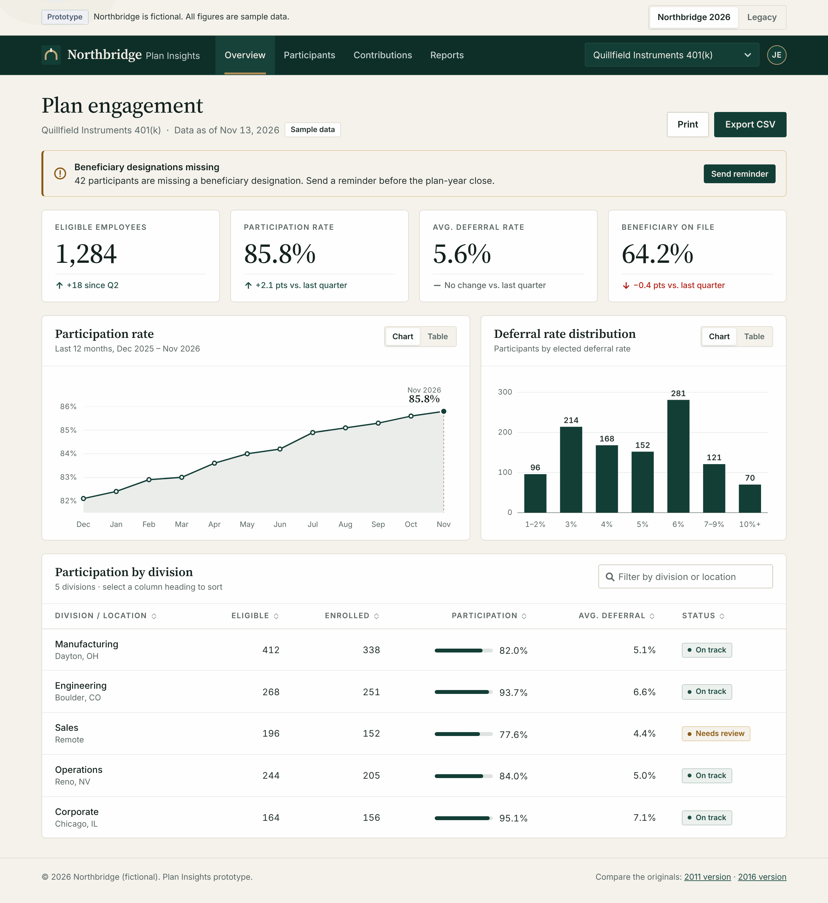

# Northbridge Plan Insights

A working React prototype of a plan-sponsor participant engagement dashboard, rebuilt from two dated designs (2011 and 2016) on the Northbridge 2026 design system.

Northbridge and Quillfield Instruments are fictional. Every figure is sample data, and the UI says so.

- **Live:** https://hartzell-design.github.io/prototype/northbridge-plan-insights/
- **Before:** [`public/legacy/legacy-a-2011.html`](public/legacy/legacy-a-2011.html), [`public/legacy/legacy-b-2016.html`](public/legacy/legacy-b-2016.html) (also linked from the app's footer)
- **Notes:** [`CASE_STUDY_NOTES.md`](CASE_STUDY_NOTES.md)
- **Screenshots:** [`docs/screenshots/`](docs/screenshots/)



## Run it

Needs Node 18 or later.

```bash
cd northbridge-plan-insights
npm install
npm run dev        # http://localhost:5173
```

| Command | What it does |
|---|---|
| `npm run dev` | Dev server with hot reload |
| `npm run build` | Type-checks, then builds to `dist/` |
| `npm run preview` | Serves the built `dist/` |
| `npm run lint:tokens` | Fails if `src/` has a hard-coded color, font family or px size |
| `npm run tokens:check` | Fails if `tokens/tokens.css` is stale against `tokens/tokens.json` |
| `npm run check` | All three: token freshness, token lint, build |

**Theme:** use the toggle in the bar above the nav, or add `?theme=legacy` to the URL. The choice is saved in `localStorage`. The theme is a single attribute, `data-theme="legacy"` on `<html>`; the default (no attribute) is Northbridge 2026.

## How it's built

- Vite + React 19 + TypeScript (strict). No UI library, no chart library, no CSS-in-JS.
- **Styling:** plain CSS files next to each component, using only the custom properties in [`tokens/tokens.css`](tokens/tokens.css). Colors always come from the semantic layer (`--nb-text-primary`, `--nb-status-warning-fg`, ...), never from primitives. The one exception file is [`src/styles/layout.css`](src/styles/layout.css), which holds three layout constants the token set doesn't cover yet.
- **Fonts:** Source Serif 4 (headings and metrics) and Inter (UI), loaded from Google Fonts. Families come from tokens, so the legacy theme falls back to all-sans by itself.
- **Charts:** hand-written SVG, measured to the container width so text stays crisp. Each chart card has a Chart/Table switch that shows the same data as an HTML table.

```
src/
  components/   Logo, Button, Badge, Tab, Field (Input, Select), Alert, KpiCard,
                ChartCard, TopNavBar, Table (TableHeader, TableRow), ThemeToggle
  charts/       ParticipationChart, DeferralChart (+ their table views)
  styles/       base.css, layout.css
  data.ts       Sample data, copied from the legacy files
  theme.ts      data-theme hook
tokens/         Northbridge tokens kit (tokens.json is the source; tokens.css is generated)
public/legacy/  The two original designs, served alongside the app for comparison
scripts/        lint-tokens.mjs
docs/           Brief and screenshots
```

## Deploying

The repository's GitHub Pages workflow runs `npm ci && npm run build` in this folder and publishes `dist/` at `/prototype/northbridge-plan-insights/`. `vite.config.ts` uses a relative `base`, so the build works from any sub-path.
